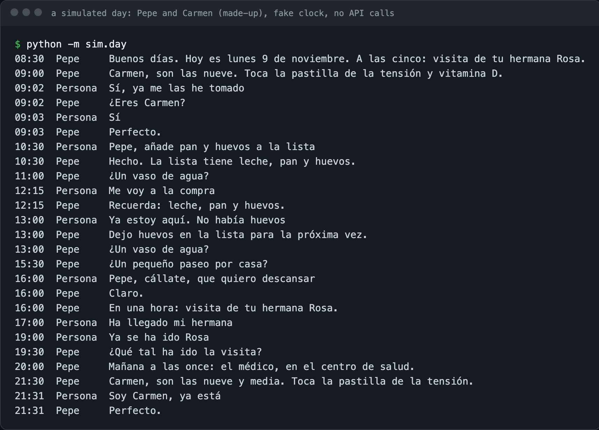
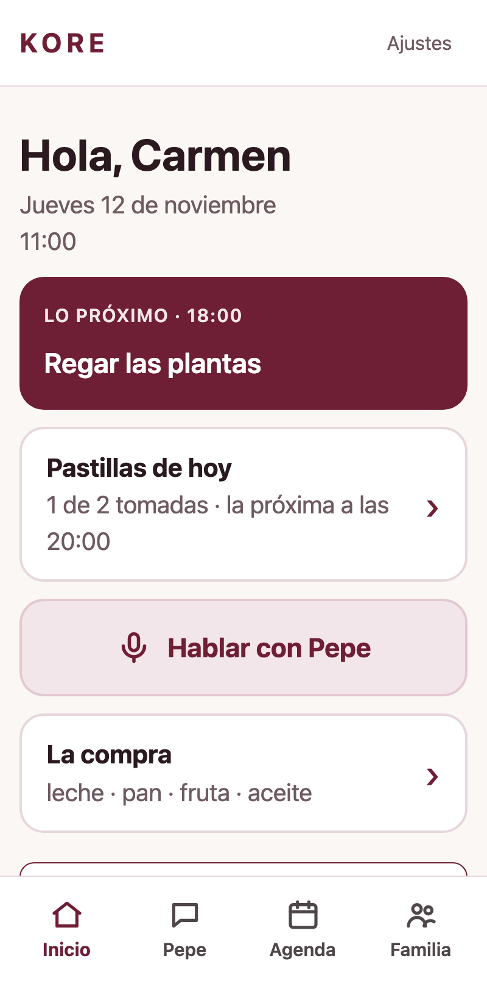
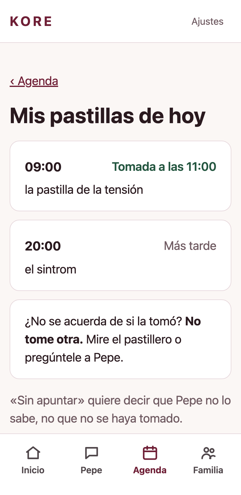
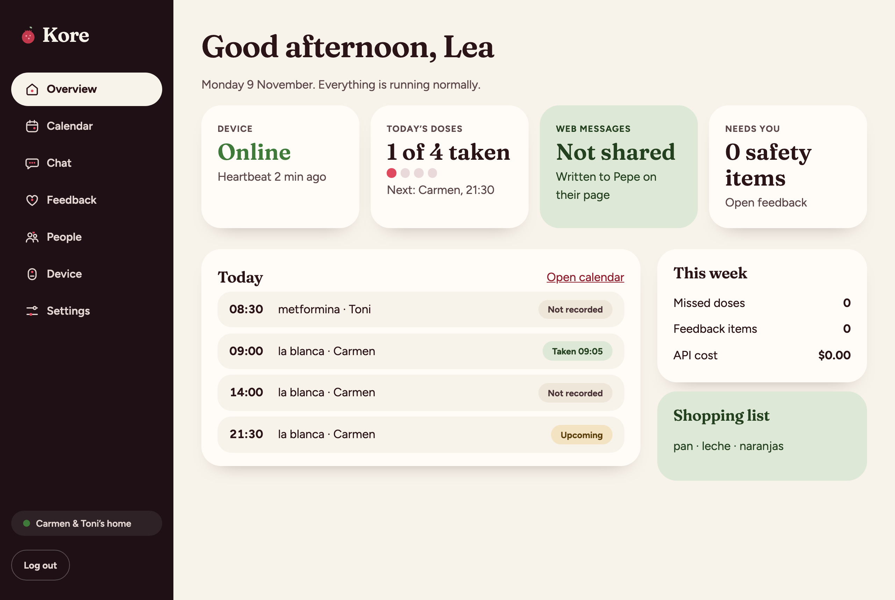

# KORE

[](https://github.com/lpesseygirod/kore/actions/workflows/ci.yml)

KORE is a voice companion for older people who speak Spanish. It's made for people who don't use apps or phones easily: you just talk to it (its default name is **Pepe**). It keeps them company, reminds them about their medicines and appointments, helps with the shopping list, shares photos and messages with their family, and can get help if something is wrong.



> Status: version 1 runs on my Mac (voice and web page), with 1,012 offline tests. The code for the Raspberry Pi box (installer, night updates, button, presence sensor, light ring, microphone) is written and tested with fake parts, but it hasn't run on a real Pi yet. Next: build the box, then a trial in a real home. All people in this repo and its demos are made up.

**Try it offline** (no API keys, made-up people, nothing is sent anywhere):

```bash
uv sync
uv run python -m sim.day           # a whole day with Pepe, in a fraction of a second
uv run python scripts/demo.py      # the home web page and the admin console
```

---

## My main design rule

The AI only decides what to say. Anything that has to be correct, like medicines, doses, reminders or messages to the family, is handled by normal code that I test. This way the AI can't make up a dose or send a message to the family without a clear yes. If a message can't be sent, KORE says it out loud.

In the code, that line is a boundary: Claude can only act through 46 tools ([`kore/brain/tools.py`](kore/brain/tools.py)), and every tool checks its own rules before touching the database ([`kore/memory/`](kore/memory)). "Pepe, ayuda" is recognised by plain code, not by the AI ([`kore/brain/language.py`](kore/brain/language.py)), and the help path works even if the AI doesn't.

## What it does

- Talks in plain Spanish, one question at a time, and says times the way people say them ("a las nueve y diez")
- Medication reminders and confirmations, with safety rules like never suggesting a double dose. It asks *who* is answering when two people live together, because "yes, I took it" from the wrong person is a medication error
- Knows when not to talk: "cállate" makes it quiet, but a same-day appointment still gets a short reminder ([`kore/manners/gate.py`](kore/manners/gate.py))
- Calendar, shopping list, weather and news
- Photos and messages with the family by Telegram (SMS as a second path for help; WhatsApp is built but switched off), plus a web app for relatives
- Help ("Pepe, ayuda", the help button on the web page, and the box's button) that works even if the AI doesn't
- A simple home screen with big text

| Logging in: Pepe says a code out loud | Carmen's home screen | Her medicines today |
|---|---|---|
|  |  |  |

The console I use to look after it (only what they agreed to share):



The website ([site/index.html](site/index.html)), in the same look, "Persephone": Kore, who brings back the spring.


## Choosing its voice

I tested three Claude models with the same conversations: someone feeling dizzy, a scam phone call, a fake message about a medicine, and "cállate".

| Model | Time to first sentence (median / slowest) | Cost per answer | What I saw |
|---|---|---|---|
| Opus 5.5 | 2.04 s / 8.01 s | $0.0042 | Very good, but too slow to talk |
| **Sonnet 5.5** | 1.34 s / 1.60 s | $0.0019 | **The best:** warm, asks before sending anything, didn't fall for the scam |
| Haiku 5.5 | 0.77 s / 1.33 s | $0.0001 | Safe, but asked three questions at once and read "09:10" as numbers |

All three refused to suggest a double dose, spotted the scam and said they were a machine. I chose Sonnet. After improving the prompt, it starts answering in about 1 second, and on my Mac a whole turn takes about 2.7 s from when you stop talking to when it starts speaking.

## How it's tested

- **1,012 offline tests** (pytest) for the parts that must be right: doses, reminders, confirmations, logins, messages, the help path
- **Scenario runs** ([`scenarios/`](scenarios)): 71 scripted conversations, each run 5 times against the real model and scored by a separate judge call. Medication, safety and honesty need 5 out of 5. The answers from the last live runs are saved in `scenarios/recordings/` and can be replayed for free (`python -m kore.scenarios.runner`), but only while the prompt and tools are unchanged. I've changed both since, so they need a new live run. The offline tests only check that every scenario still builds and runs, with a stand-in model
- **A fake clock**, so a whole day (or a week of missed doses) runs in a fraction of a second ([`sim/day.py`](sim/day.py))

## Run it

Python 3.12+ and [uv](https://docs.astral.sh/uv/).

```bash
uv sync
uv run pytest                                   # 1,012 tests, offline
uv run python scripts/demo.py                   # web page demo (test mode)
uv run python -m kore.home --offline            # Pepe in the terminal, offline phrases only (free)
cp .env.example .env                            # then add your keys
uv run --env-file .env --group live python -m kore.home --voz   # talk to Pepe out loud on a Mac
```

On a Mac, `--voz` only needs an Anthropic key: it uses the Mac's own speech recognition and voice. The box uses ElevenLabs for both, so it needs an ElevenLabs key too. My guide for setting up the Raspberry Pi box is in [`docs/DEVICE.md`](docs/DEVICE.md), and the parts list in [`docs/HARDWARE.md`](docs/HARDWARE.md).

## Project layout

```
kore/brain/       the conversation with Claude, and the tools it may use
kore/memory/      SQLite: people, medicines, doses, lists, notes (all the rules live here)
kore/scheduler/   reminders and the clock
kore/manners/     when to speak, and when not to
kore/family/      messages, help, heartbeat, backups
kore/feedback/    what they tell Pepe about how it behaves
kore/setup/       the first conversation, by voice
kore/info/        weather and news
kore/web/         the home web page, the family app and the admin console
kore/home/        the voice loop: microphone, speech, the Pi box
kore/hardware/    the box's button, presence sensor and light ring
kore/scenarios/   the scenario runner and the judge
sim/              a simulated day with a fake clock
deploy/pi/        systemd services, the installer and night updates for the Raspberry Pi
site/             the public website (static)
docs/             the product design (PEPE.md), my plans, device and hardware guides, design canvases
```

## How I built it

I designed KORE: the product (in [`docs/PEPE.md`](docs/PEPE.md)), the safety rules and the screens. I planned it with an AI advisor ([`docs/BUILD-PLAN.md`](docs/BUILD-PLAN.md)) and built it with Claude Code, phase by phase, with tests and live checks at each step. The commit history shows that progression.

## Next: its own model

Right now KORE uses Claude. My goal is to train an open-source model (Qwen or Gemma) only for KORE, running on the device itself. That way conversations stay at home, there's no cost per answer, and it doesn't depend on one company. It will only replace Claude once it passes the same tests, and anything about medicines or safety has to pass 5 times out of 5.

## Built with

Python, Claude API, Starlette, SQLite, ElevenLabs, Apple speech recognition, Telegram and Twilio SMS. Target hardware: Raspberry Pi 5

[Lea Pessey Girod](https://github.com/lpesseygirod) · MIT licensed
